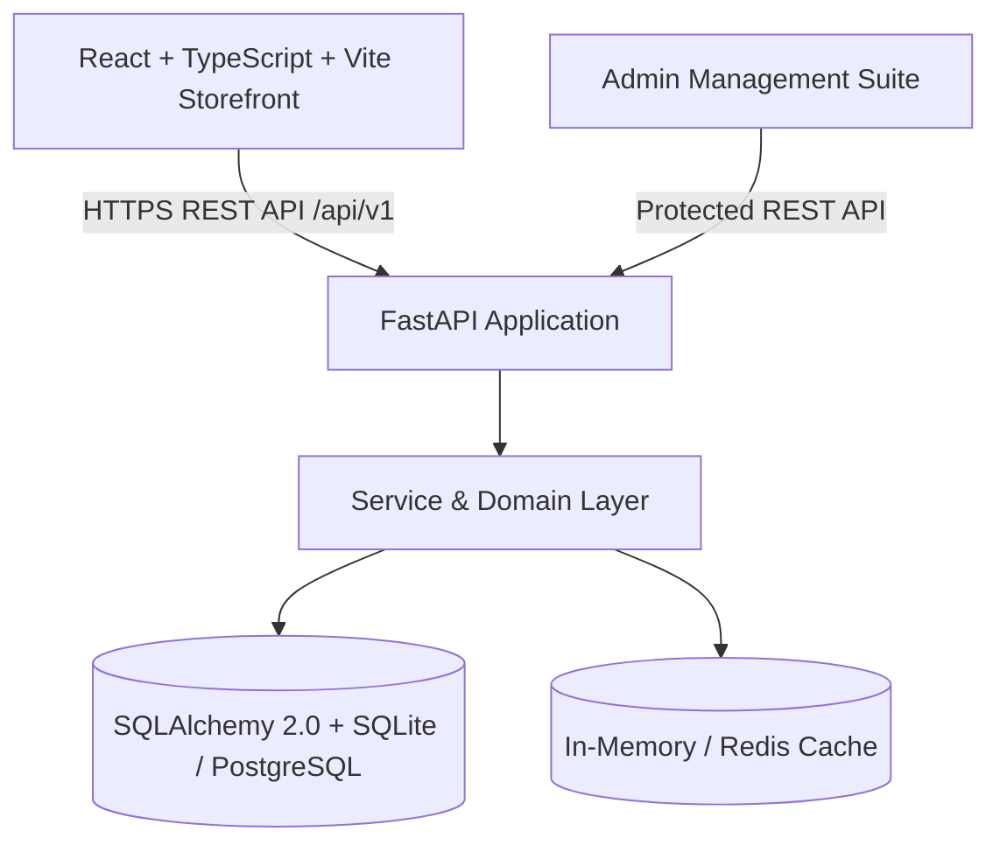

# YoungINApparels Implementation Plan & Architecture

YoungINApparels is a luxury editorial direct-to-consumer apparel brand inspired by the Radian theme aesthetic (Axiom Themes). It features high-contrast editorial blocks, deep crimson accents, sleek typography, shoppable lookbook hotspots, responsive commerce flows, and an integrated admin CMS.

## 1. System Architecture

## 2. Technical Stack
- **Frontend**: React 18, TypeScript, Vite, Tailwind CSS with customized Radian design tokens, Lucide React icons, TanStack Query / React Context for state management.
- **Backend**: Python 3.11, FastAPI, Pydantic v2, SQLAlchemy 2.0 ORM, SQLite (production-ready config with PostgreSQL compatibility), Uvicorn.
- **Visual Design**: Radian aesthetic: `#0A0A0A` near-black editorial panels, `#FFFFFF` crisp commerce canvas, `#B51224` campaign red highlights, `#5D0712` deep crimson, `#F7F6F4` warm neutral, bold uppercase editorial typography.

## 3. Implementation Steps

### Phase 1: Project Scaffolding & Design System
- Setup FastAPI backend with dependencies, database schemas, seed generator, and API routes.
- Setup React + TypeScript + Vite frontend with Tailwind design tokens, typography, and SVG assets.
- Generate high-fashion editorial imagery for YoungINApparels campaign hero, lookbooks, product catalog, and collection thumbnails.

### Phase 2: FastAPI Backend Engine
- Database Models: `Product`, `ProductVariant`, `ProductImage`, `Collection`, `Inventory`, `Order`, `OrderItem`, `Discount`, `User`, `LookbookHotspot`, `CMSContent`.
- REST Endpoints:
  - Catalog: `/api/v1/products`, `/api/v1/products/{slug}`, `/api/v1/collections`, `/api/v1/collections/{slug}`
  - Search & Suggestions: `/api/v1/search`, `/api/v1/search/suggestions`
  - Cart & Checkout: `/api/v1/cart`, `/api/v1/checkout/quote`, `/api/v1/orders`
  - Lookbook Hotspots & CMS: `/api/v1/cms/homepage`, `/api/v1/lookbook`
  - Admin Endpoints: Products CRUD, Inventory management, Order fulfillment status, Promo codes, CMS live editor
  - Seed database with 12+ luxury streetwear & tailored garments (hoodies, trench coats, washed denim, knitwear, bombers, accessories), real variant SKUs, sizing, and inventory.

### Phase 3: Frontend Storefront Experience
- **Header & Announcement Marquee**: Sticky header, brand wordmark, desktop mega-navigation, search trigger, currency selector, cart drawer badge, mobile navigation drawer.
- **Hero & Story Circles**: Full-bleed campaign hero banner with CTA and video/lookbook link; circular story thumbnails with horizontal scroll.
- **Discovery Tabs & Product Grid**: New Arrivals, Best Sellers, Sale tabs; high-fashion product card with hover secondary photo, quick-buy size selector, color swatches, sale discount badges.
- **Shoppable Lookbook / Hotspot Section**: Interactive campaign image with pulsating pins revealing product cards and instant Add to Cart.
- **Editorial Split & Brand Manifesto**: Asymmetric high-contrast editorial blocks with high-fashion imagery and craftsmanship storytelling.
- **Collection Page**: Multi-filter drawer (Category, Size, Color, Price range, In-stock), sorting, responsive grid.
- **Product Detail Page (PDP)**: Multi-photo gallery with zoom and thumbnails, color & size selectors, live stock indicator, interactive Size Chart Modal, fit/fabric accordions, quantity selector, sticky mobile ATC, recommended cross-sells.
- **Slideout Cart Drawer**: Free shipping meter ($150 threshold), line item quantity controls, discount code applicator, slide-in animation.
- **Checkout Flow**: Multi-step checkout with contact, shipping, priority delivery, card/payment simulation, server-side validation.
- **Order Confirmation**: Receipt summary, live shipment tracking stepper, order print view.
- **Admin Portal**: Complete management interface for products, orders, discounts, inventory levels, and homepage CMS configuration.
- **Brand & Policy Pages**: About Brand Story, Contact form, FAQ accordion, Shipping & Returns, Size Guide, Privacy, Terms.

### Phase 4: Polish, Testing & Verification
- End-to-end testing with browser subagent.
- Responsive mobile & desktop validation.
- Unit and integration tests for backend & frontend.
